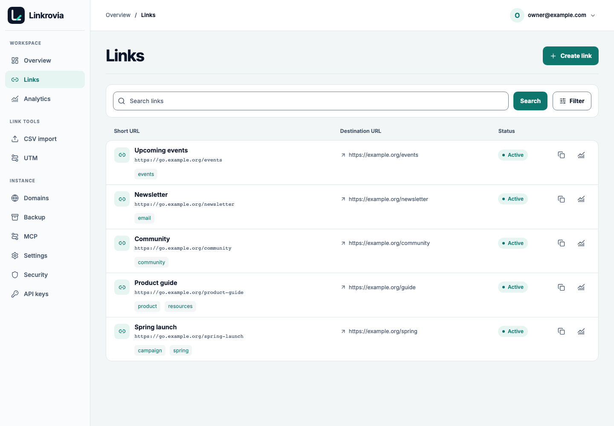
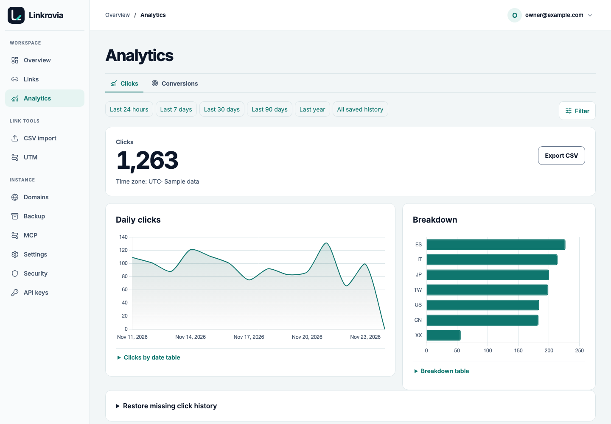

<picture>
  <source media="(prefers-color-scheme: dark)" srcset="static/brand/logo-dark.svg" />
  <source media="(prefers-color-scheme: light)" srcset="static/brand/logo-light.svg" />
  
</picture>

# Linkrovia

**Branded short links, smart redirects, and click analytics on your own Cloudflare account.**

Linkrovia is an open-source URL shortener for Cloudflare Workers. Use your own domain for short links, send visitors to the right destination, and see how each link performs. A single Worker serves the dashboard, handles redirects, and runs scheduled analytics jobs.

You can finish setup and start using short links before [enabling click analytics](docs/deployment.md#enable-click-analytics).

## See it in action

**Find and manage your links.** Search by title or short path, open filters for domain, status, and tag, and copy a URL from the results. A saved link keeps its short URL and copy action visible while you work through configuration, performance, and sharing.

**See which links are working.** Choose a date range to view the trend and traffic breakdown. Open the report filters to refine the results or a saved link to explore its own clicks, conversions, and CSV exports. The screenshot uses sample analytics.

## What you can do

- **Route and schedule.** Open **Redirect rules** on a saved link to route visitors by device, operating system, location, or language. Test the rules in the simulator. Set start and expiration times, and apply reusable UTM templates to each destination.
- **Control access.** Create password-protected or one-time links, download QR codes, and sign in to the admin dashboard with passkeys. Owners can invite administrators and enable Cloudflare Turnstile for sign-in.
- **Measure results.** Click collection starts with your first redirect after Analytics Engine is enabled. Explore reports by link, domain, and traffic source. Define conversion goals and send events from your server.
- **Automate and migrate.** Import links from CSV, export portable configuration backups, and use scoped API keys for REST or MCP. The admin dashboard includes examples for Codex, Claude Code, GitHub Copilot, VS Code, Cursor, and Gemini CLI.

The dashboard supports English, Japanese, Simplified Chinese, Traditional Chinese, Spanish, Italian, and French, with light and dark themes and user-selectable time zones.

## Get started

1. Deploy to your Cloudflare account and open the published HTTPS address. If Cloudflare asks for an account subdomain, follow the [deployment guide](docs/deployment.md#if-the-worker-address-does-not-open).
2. Open the Worker's `workers.dev` address to start setup. Enter the private `SETUP_TOKEN` you set during deployment (32–512 characters), then choose the management hostname and register your owner passkey. [Connect domains](docs/domains.md)
3. Create a short link, open it in another tab, and check its report under **Link analytics**.

Linkrovia is in active development. Workers Builds deployment, guided custom-domain setup, and direct passkey registration on the chosen hostname have been verified. Fresh-account provisioning through the Deploy to Cloudflare button is still being verified. [Deployment status](docs/deployment.md)

## Documentation

- [Deployment](docs/deployment.md), [domains](docs/domains.md), and [upgrades](docs/upgrading.md)
- [Analytics and conversions](docs/analytics.md), [backup and restore](docs/backup.md), and [operations](docs/operations.md)
- [MCP client setup](docs/mcp.md) and the [OpenAPI 3.1 contract](static/openapi.yaml), also available at `/openapi.yaml` on deployed instances
- [Local development and tests](docs/development.md), [translation](docs/translation.md), and [changelog](CHANGELOG.md)

## Project and branding

The project website is [linkrovia.com](https://linkrovia.com). Self-hosted instances use the operator's configured hostnames and can customize the app name, logos, favicon, and primary color. See the [brand guide](docs/BRAND.md) for assets and usage.

## License

Linkrovia is released under the [MIT License](LICENSE).
